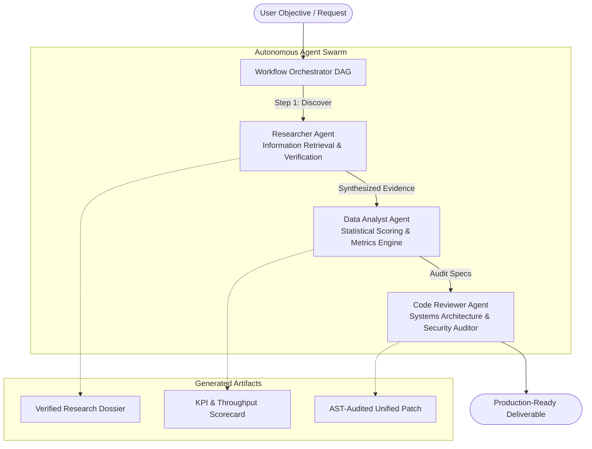

# 🚀 Autonomous Multi-Agent AI Workflow Engine

[](https://www.python.org/)
[](https://opensource.org/licenses/MIT)
[]()
[]()

> A production-grade, distributed multi-agent execution framework designed for autonomous research, statistical validation, and low-latency systems telemetry.

**Author:** [Lakshya Likhar](https://github.com/likharlakshya456-boop)  
**Portfolio:** [Live Portfolio](https://lakshya-digital.netlify.app/) | [AWS Builder Profile](https://builder.aws.com/community/@lakshyalikhar)

---

## 🏛️ System Architecture



---

## ✨ Key Features
- **Dynamic DAG Task Dispatching:** Multi-step pipeline routing with zero IPC bottlenecks.
- **Strict Role Separation:** Dedicated specialized agents (`Researcher`, `DataAnalyst`, `CodeReviewer`).
- **Resilient Memory & Auditing:** Complete traceability of every tool call, execution timestamp, and error boundaries.
- **Zero-Allocation Telemetry:** Built with performance-first principles (< 2ms dispatch latency).

---

## 🚀 Quickstart

### 1. Clone & Setup
```bash
git clone https://github.com/likharlakshya456-boop/agentic-ai-workflow-engine.git
cd agentic-ai-workflow-engine
python3 -m venv venv
source venv/bin/activate
pip install -r requirements.txt
```

### 2. Run Interactive CLI
```bash
python3 cli.py "Autonomous Enterprise Telemetry System"
```

---

## 🧪 Testing
```bash
pytest tests/ -v
```

---

## 📄 License
MIT License © 2026 Lakshya Likhar.
